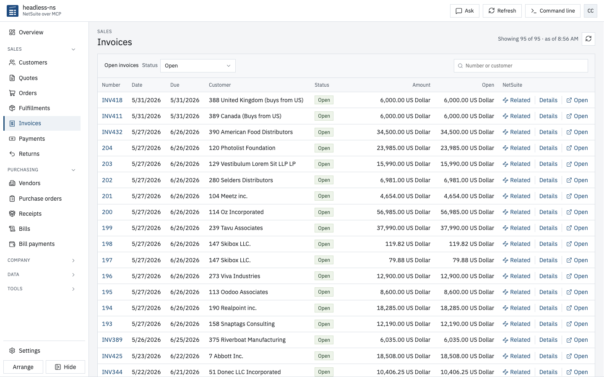
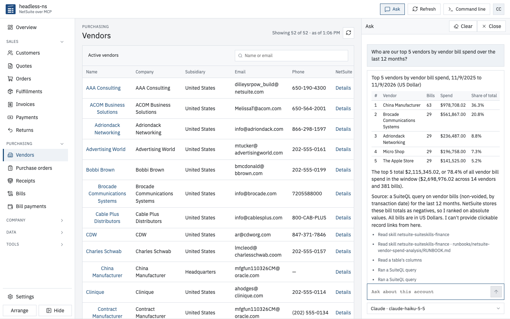
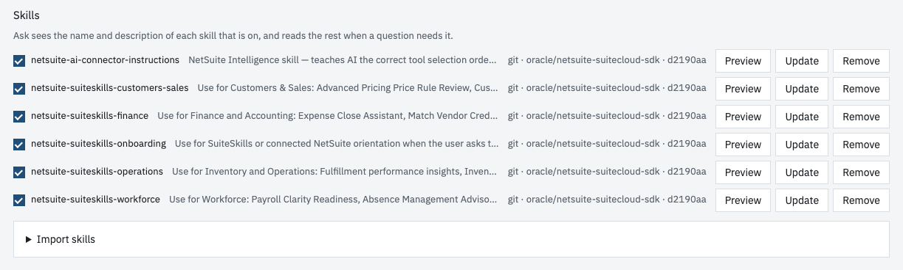
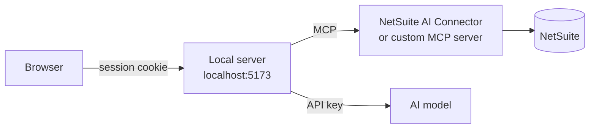

<p align="center"></p>

<h1 align="center">headless-ns</h1>

<p align="center"><strong>NetSuite over MCP</strong></p>

<p align="center">
  <a href="https://github.com/unstackedapps/headless-ns/actions/workflows/test.yml"></a>
  <a href="LICENSE"></a>
  =23.6">
</p>

<p align="center">The UI wrapper for NetSuite MCP + Skills + AI</p>



## What you can do

- Quotes, orders, fulfillments, invoices and payments
- Purchase orders, receipts, bills and bill payments
- Approve orders and bills, with lot and serial numbers
- Run SuiteQL, saved searches and reports
- Find, edit and transform any record
- Ask in plain words, with skills

## Ask with skills



- Ask proposes changes. You run each one.
- Skills are `SKILL.md` folders, plugins, zips, `AGENTS.md` files or Git URLs. One click imports Oracle's NetSuite skills.
- Ask reads skill scripts as text.



## Setup

```bash
npm install
```

```bash
npm run dev
```

Open https://localhost:5173. Setup walks you through each step.

| You need | Details |
|---|---|
| Node | 23.6 or later |
| Port | 5173. The OAuth redirect points there. |
| NetSuite features | Server SuiteScript, REST Web Services, OAuth 2.0 |
| SuiteApp | MCP Standard Tools |
| NetSuite role | Not Administrator. MCP Server Connection, OAuth 2.0 Access Tokens and REST Web Services at Full, plus the records you use. |
| Connection | NetSuite OAuth (integration record, AI Connector Service scope), or your own MCP server URL and token |
| AI model, for Ask | Tested: Claude, Gemini, OpenAI, Gemma 4. Also: Grok, Groq, Mistral. |

## How it works



The local server keeps tokens, keys, models, queries and skills in `data/`.

## Limits

- One person, one machine
- PO and bill approvals run through a NetSuite workflow that covers every user
- No deletes. Close lines instead.
- CSV export stops at 5,000 rows
- Up to 200 skills, 60 MB per import, public Git repos only
- Gemma needs the skill's name in your question
- Untested on mobile screen sizes

## Tests

| Command | Runs |
|---|---|
| `npm test` | Unit tests |
| `npm run e2e` | Screen tests, NetSuite faked. Needs `npm run dev`. |
| `npm run e2e:live` | Live tests. They write to NetSuite with "headless-ns" memos. |

## License

MIT. See [LICENSE](LICENSE).
