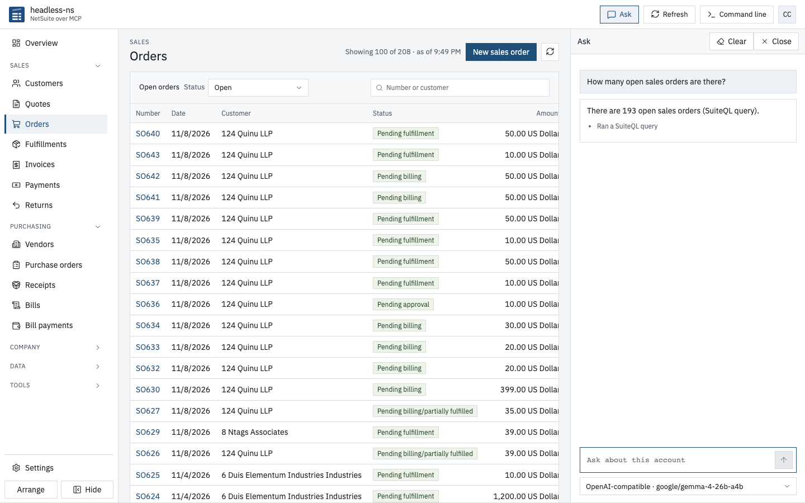
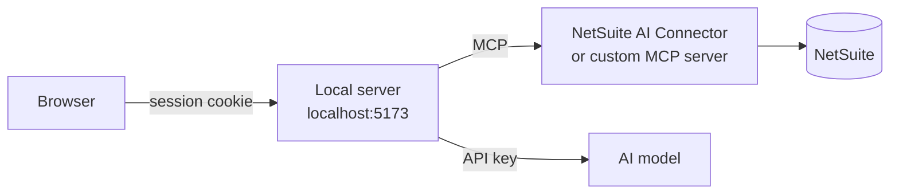

<p align="center"></p>

<h1 align="center">headless-ns</h1>

<p align="center"><strong>NetSuite over MCP</strong></p>

<p align="center">
  <a href="https://github.com/unstackedapps/headless-ns/actions/workflows/test.yml"></a>
  <a href="LICENSE"></a>
  =23.6">
</p>

<p align="center">A browser app for NetSuite. It reads and writes your account through NetSuite's AI Connector, signed in with NetSuite OAuth, or through a custom MCP server such as OpenSuiteMCP.</p>



## What you can do

- Create a quote, turn it into a sales order, fulfill it, invoice it and take payment.
- Raise a purchase order, receive it, bill what arrived and pay one bill or several.
- Approve or reject sales orders, purchase orders and bills.
- Enter lot and serial numbers on receipts and fulfillments.
- Run SuiteQL in the Query editor, page through the rows, save the query and download a CSV.
- Find any record by number, name or email, and open, edit, transform or attach a file to it.
- Run saved searches and saved reports, and browse the file cabinet.
- Ask questions in plain words. Ask reads the account and proposes changes, and nothing changes until you confirm.
- Type commands in the command line: `open`, `sql`, `ask`, `confirm`, `theme` and more.

## What it needs

- Node 24. The tests load TypeScript files directly, which needs Node 23.6 or later.
- A NetSuite account set up like this:
  - Features, under Setup > Company > Enable Features: Server SuiteScript on the SuiteCloud tab, REST Web Services under Web Services, and OAuth 2.0 under Manage Authentication.
  - The MCP Standard Tools SuiteApp, from SuiteCloud > SuiteApp Marketplace.
  - A role other than Administrator, with MCP Server Connection, Log in using OAuth 2.0 Access Tokens and REST Web Services at Full, plus View or Edit on the records you use: customers, vendors, items, transactions and files. Assign it to each person who signs in.
- One way to connect:
  - NetSuite OAuth: an integration record with State set to Enabled, Authorization Code Grant, only the NetSuite AI Connector Service scope, and the redirect URI that setup shows.
  - A custom MCP server URL and bearer token. OpenSuiteMCP and Mint (Mintive) are tested.
- An AI model key for Ask, if you want Ask. Claude, Grok, Gemini, OpenAI, Groq, Mistral and OpenAI-compatible hosts are listed. Claude, Gemini, OpenAI and an OpenAI-compatible host running Gemma 4 are tested live.
- Port 5173. The NetSuite integration's redirect URI points there.

## Quick start

```bash
npm install
```

```bash
npm run dev
```

Open https://localhost:5173. Setup walks you through connecting NetSuite, then an AI model, and runs a test read for each. The first run makes a self-signed certificate in `certs/`.

## How it works



- NetSuite stays the system of record. headless-ns keeps no copy of your data, except NetSuite's record types, tables and fields, which it caches for a day in `data/metadata-<account>.json`.
- The browser holds only an httpOnly session cookie. NetSuite tokens and model keys stay on the local server.
- Saved models live in `data/models.json` and saved queries in `data/queries.json`. Git ignores `data/`.

## Limits

- It runs on one machine for one person.
- The screens never delete records. To stop a line, close it.
- SuiteQL returns at most 5,000 rows, so the CSV export stops there.
- Some accounts refuse NetSuite's approve action. headless-ns then approves a sales order by setting its status to Pending Fulfillment.
- Purchase order and bill approval uses the "headless-ns approval - PO and Bill" workflow. While it is on, every PO and bill waits for approval, for every user.
- Narrow screens get a simpler layout, but nobody has tested it on a phone.

## Tests

```bash
npm test
```

Unit tests for the server and the shared client code.

```bash
npm run e2e
```

Screen tests click through the app in Chromium with NetSuite's answers faked. Start `npm run dev` first. The first run needs `npx playwright install chromium`.

```bash
npm run e2e:live
```

Live tests write to NetSuite. They create quotes, orders, fulfillments, invoices, payments, purchase orders, receipts and bills with memos that start with "headless-ns", such as "headless-ns workflow test". Sign in once in a browser first.

## License

MIT. See [LICENSE](LICENSE).
